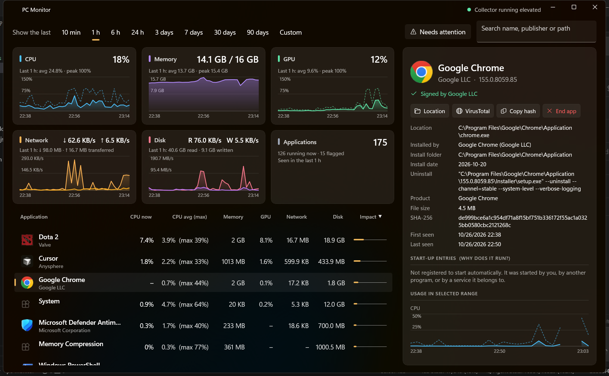
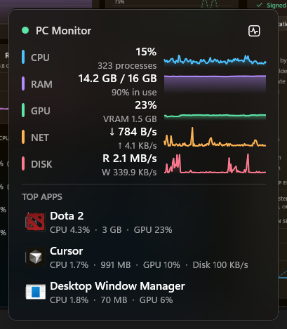
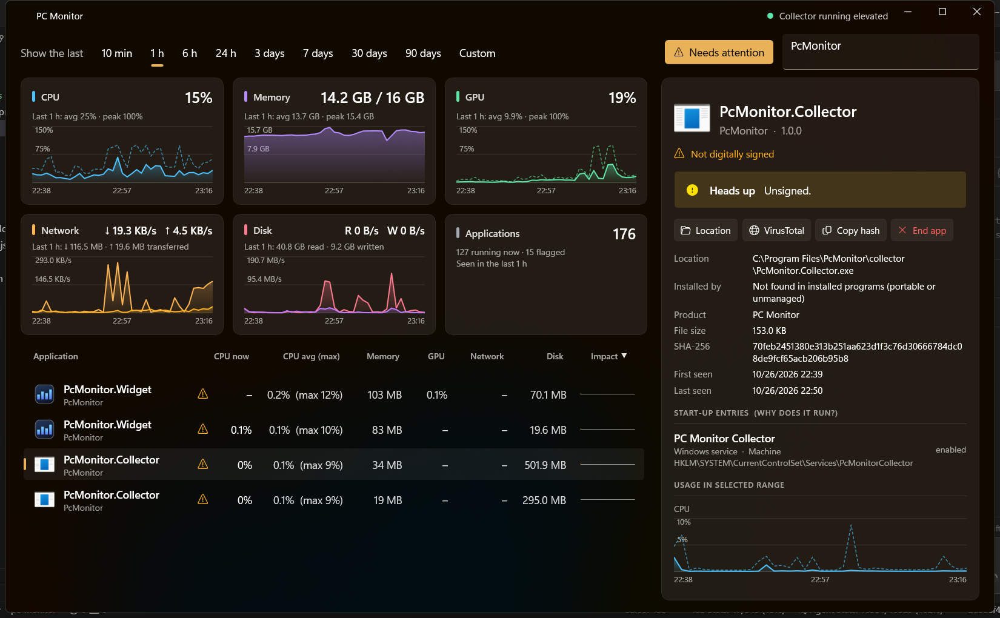
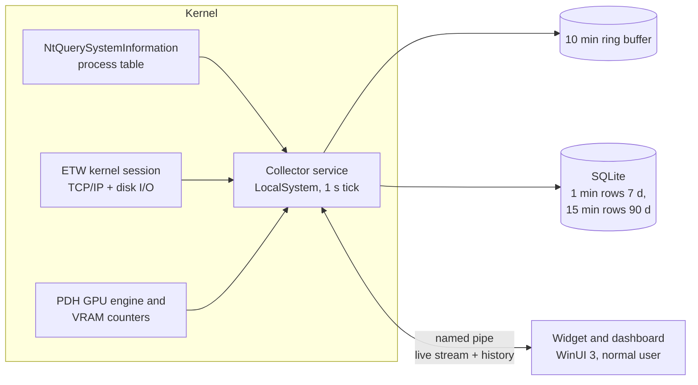

<div align="center">

# PC Monitor

**See which apps are really using your PC, right now and hours ago.**

A glassy, always-on-top Windows 11 widget and dashboard that records CPU, memory, GPU, network and disk **per application**,
shows where each app lives and why it starts, and flags the ones that look suspicious.




</div>

## Why

Sometimes a program you never opened is eating your CPU, GPU or bandwidth, and by the time you open Task Manager it has gone quiet.
PC Monitor keeps the history, so you can ask *"what was hammering my machine at 3 am?"* and get an answer with the app's icon,
publisher, signature, install location and the network hosts it talked to.

## Highlights

| | |
|---|---|
| **Per-app, not per-process** | Every process of one executable is grouped into one application, with its own icon, publisher and history. |
| **Any time range** | 10 minutes to 90 days, or type any number of hours. |
| **Real measurements** | Exact per-app network and disk bytes from the kernel's ETW events, GPU engine counters, private working set for memory. |
| **Know who it is** | Install location, signer, version, SHA-256, matching installed program or Store package, and every autostart entry that launches it. |
| **Spots the creepy ones** | Flags unsigned or tampered binaries, apps running from `%TEMP%`/`AppData`/Downloads, heavy use with no visible window, GPU load while you are away, and apps talking to many hosts. |
| **Act on it** | Open the file location, look up the hash on VirusTotal, end a whole app or a single process, switch an autostart entry on or off. |
| **Nearly free** | The collector uses well under 1% of one core and about 15 MB; the hidden widget costs about 0.1%. |
| **Starts with Windows** | A service for collection, the widget at sign-in. |

## The widget

<p align="center">
  
</p>

A frosted-glass pill that stays on top of your windows: live totals with two minutes of sparklines and the three heaviest apps.
Drag it anywhere (it snaps to screen edges), right-click for options, double-click to open the dashboard.
When it is hidden it closes its connection to the collector, so it costs nothing.

## The dashboard

<p align="center">
  
</p>

- Five history charts (CPU, memory, GPU, network, disk) with a hover read-out and gaps drawn as gaps.
- A sortable, searchable application list with icons, publisher, average and peak usage, and an impact score.
- **Needs attention** filter for unsigned apps and the behaviours listed above.
- A details panel for the selected app: identity, startup entries, usage charts, running processes and network peers.

## How it works



- **Two processes.** A small Windows service does the privileged sampling; the UI runs as you and never needs elevation.
- **One system call per second** reads the whole process table (CPU, memory, I/O, threads), so there is no per-process polling.
- **ETW** gives exact bytes per process for network and physical disk I/O, plus the remote endpoints each app talked to.
- **GPU** utilisation and VRAM come from the Windows GPU performance counters; an app's value is its busiest engine.
- **Storage is tiny.** Only apps that were significant at least once in a minute get a row, so the database stays small without hiding anything that mattered. Old minute rows are rolled up into 15-minute rows.
- **Identity** (version info, signature, hash, install source) is resolved once per executable on a low-priority thread and cached.
- **Live data is only sent when someone is looking.** With no window visible the collector builds no frames at all.

### Security notes

- The collector runs as LocalSystem only so it can open the ETW session. The pipe is restricted to SYSTEM, Administrators and interactively signed-in users.
- Actions (end process, change startup entry) run while *impersonating the caller*, so the widget can never do more than you could do yourself.
- The history folder is locked down to SYSTEM, Administrators and the account running the collector.
- Nothing leaves your machine. The VirusTotal button only opens a lookup page for the file's hash; the file is not uploaded.

## Install

See **[INSTALL.md](INSTALL.md)**. In short, from the repository folder:

```powershell
.\installer\build.ps1                       # publishes and builds artifacts\PcMonitor.msi
# then double-click artifacts\PcMonitor.msi, or run installer\install.ps1 from an elevated PowerShell
```

Requires Windows 11 x64. Everything needed, including the .NET runtime, is bundled.

## Measured overhead

Release build, 16 GB machine, collector not elevated, 60-second samples:

| | CPU (of one core) | Private memory |
|---|---|---|
| Collector, no UI connected | 0.3% | 15 MB |
| Collector, widget streaming | 0.6% | 18 MB |
| Widget hidden in the tray | 0.1% | 5 MB |
| Widget, compact pill only | 0.9% | 91 MB |
| Widget, pill + dashboard | 5.5% | 59 MB |

Run `tools\measure.ps1 -Name PcMonitor.Collector -Seconds 60` to measure your own machine.

## Project layout

```
src/PcMonitor.Core        shared models, pipe protocol, impact score, suspicion rules
src/PcMonitor.Collector   Windows service: samplers, aggregation, SQLite storage, identity, IPC server
src/PcMonitor.Widget      WinUI 3 app: compact widget, dashboard, tray icon
tests/                    xUnit tests (sampling maths, rollups, identity, IPC integration)
installer/                WiX v5 MSI and install/uninstall scripts
tools/                    measurement and screenshot helpers
```

Build and test from source (.NET 9 SDK):

```powershell
dotnet build PcMonitor.sln
dotnet test PcMonitor.sln
```

## Known limits

- Per-app **network and per-app disk throughput need the collector to run elevated** (the installer does this). Without it those columns show "n/a" or fall back to process I/O counters.
- GPU usage is only reported for drivers that expose the Windows GPU performance counters (all current WDDM 2+ drivers do).
- Network figures are bytes seen by the TCP/IP stack per process; loopback and local-to-local traffic are excluded.

